

  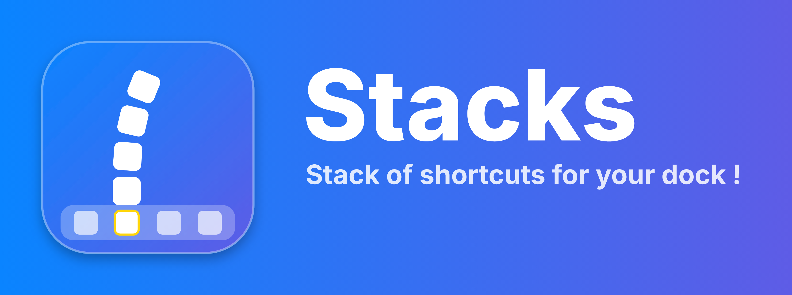

# Stacks

**🇬🇧 English** · [🇫🇷 Français](#-français)

**Stacks !** Stack of shortcuts for your dock, like the stacks of Mac OS X Leopard, on iOS 16 !

Swipe up on an icon of your dock and a curved stack of up to 5 apps, web clips or web apps comes out of it !

> 🛒 Havoc shop : [https://havoc.app/package/stacks](https://havoc.app/package/stacks)

# ***Features* :**

**• Up to 20 apps on your dock (4 × 5 = 20 !) :**
- Put a stack on every icon of your dock : 4 stacks × 5 apps = 20 apps on every page, right from your dock (25 with FiveIconDock !).
- Each stack is numbered in the settings preview (1, 2, 3…) in the order you create it.
- Each stack has its own curve : style 1 / 2 / 3, curvature and direction. All the other settings are shared by all the stacks.
- Only one stack opens at a time.

**• Handle style :**
- 6 handles to show where your stacks are : Double chevron, Chevron, Bar, Three dots, Stack preview or None.
- Stack preview (default) : the top of the 1st app of the stack peeks out above the dock icon.

**• Delete a stack with a poof :**
- Hold your finger 3 s on the selected icon in the preview : the outline turns red and the icons wiggle.
- Then the outline blinks for 3 s (tap anywhere to cancel), and the icons go up in smoke one after another, with a sound.

**• Lock the stacks :**
- One switch greys out all the settings and closes the stack of the preview.
- Its Test button opens all your stacks at once for 3 s.

**• A stack on your dock :**
- Choose any app of your dock by touching it in the settings preview, and up to 5 apps, web clips or web apps for its stack.
- Swipe up on that dock icon to open the stack, tap an icon to launch it, tap anywhere else to close it.
- A small grabber above the dock icon shows where your stack is.

**• Mac OS X Leopard style :**
- The icons lie flat against a bent plank.
- 3 styles : the stack curves from the dock (style 1), after the 1st icon (style 2) or after the 2nd icon (style 3).
- Adjust the curvature with a slider, and curve the stack to the left or to the right.
- The icons slide out of the dock icon along the plank, and slide back the same way.

**• App names :**
- Show the name of the apps to the left, to the right or below their icon, following the curve of the stack.
- Mac OS style or iOS style.

**• Customize the background and the animation :**
- Adjust the blur and the dimming of the background, from 0 to 100 %.
- Adjust the speed of the opening / closing animation.

**• Live preview :**
- A preview of your dock and your stack in the settings, updated as you move the sliders.

**• 100 % compatible with FiveIconDock :** a stack on each of your 5 dock icons.

# ***Settings live in* :**

**Settings --› Stacks** (A respring is not needed to apply all changes).

# ***Screenshots* :**

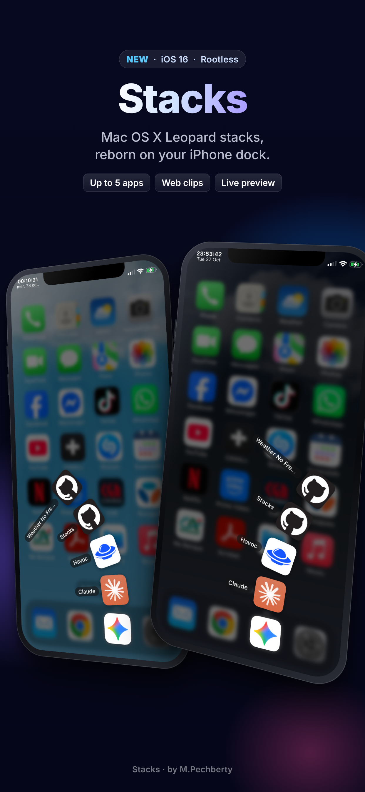 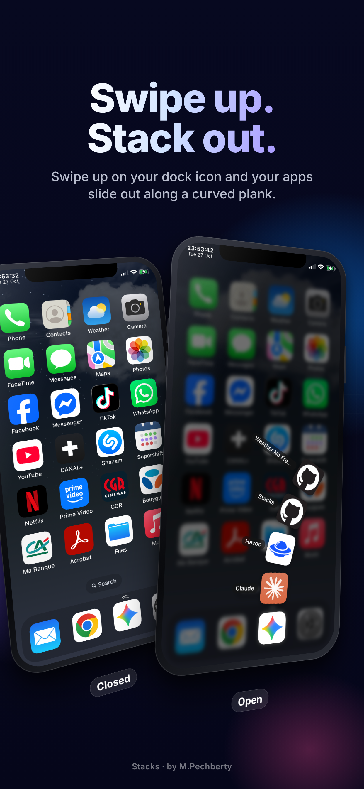 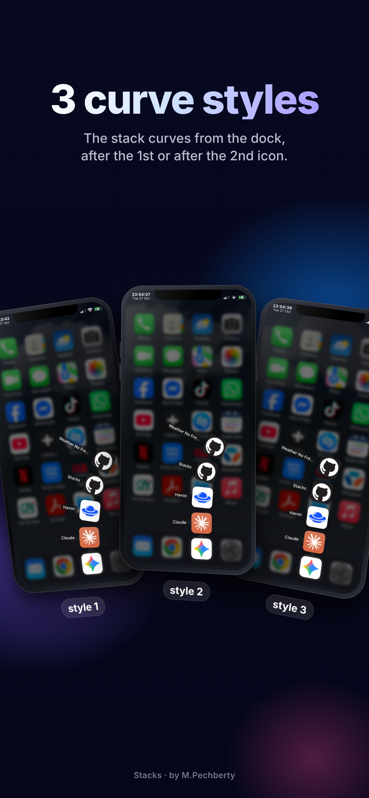 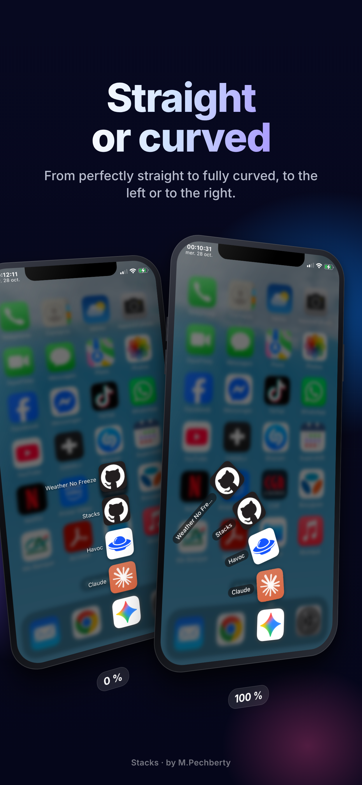
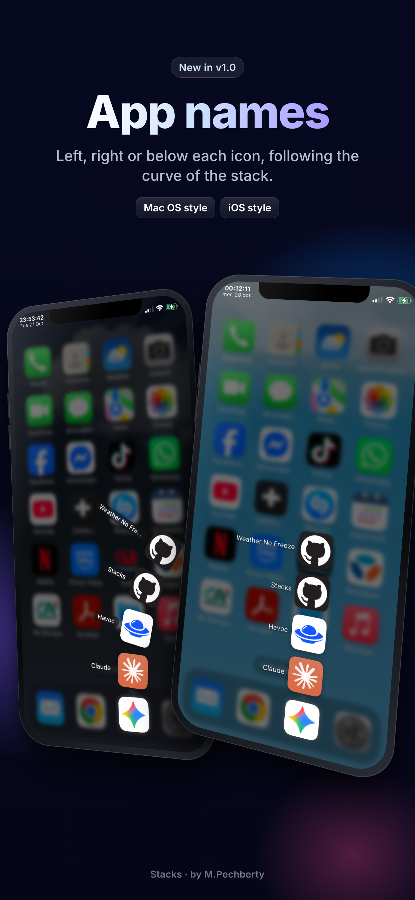 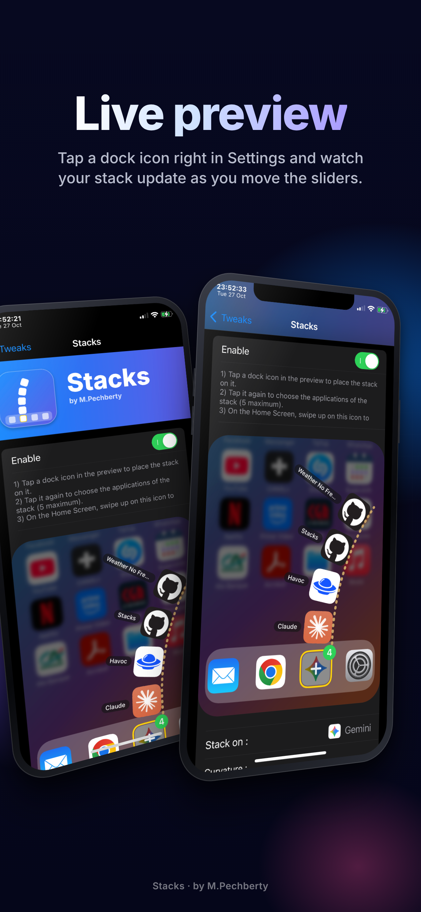 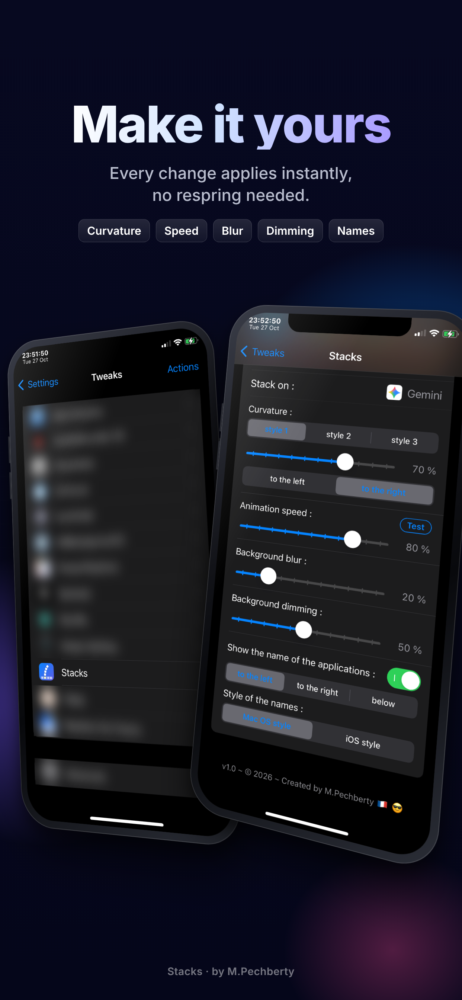 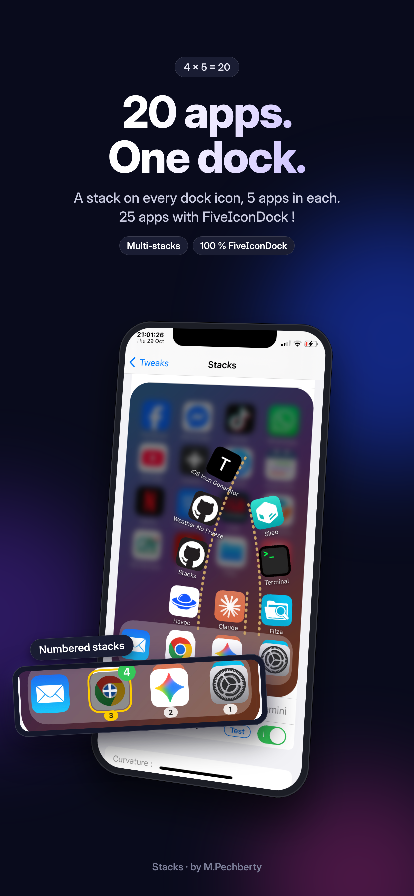
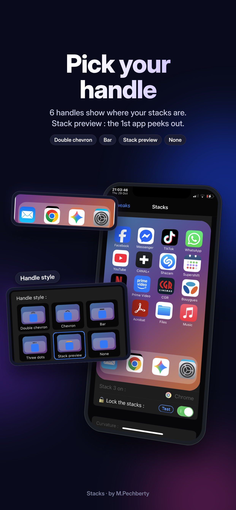 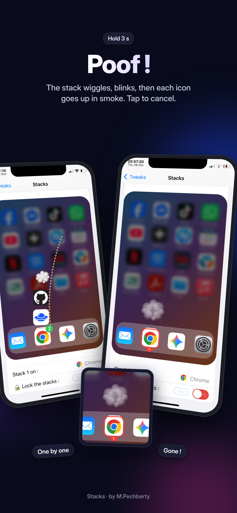 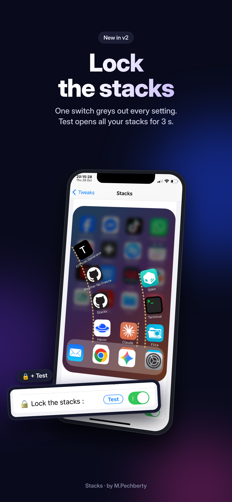

# ***Compatibility* :**

- iOS : 16 --> 16.7.XX

- Jailbreak : Rootless

- Requires : PreferenceLoader

- Tested only on : iPhone X - iOS 16.7.12

# ***Other iPhones or other iOS versions ? :***

Help me test other devices !

If you try Stacks on another iPhone or other iOS versions, please tell me if it works (model + iOS version = works, doesn't work or bug) :

https://github.com/MPechberty/Stacks/issues

# ***Support* :**

**Report an issue on GitHub :** 

https://github.com/MPechberty/Stacks/issues

© 2026 – Created by M.Pechberty 🇫🇷 😎

---

---

## 🇫🇷 Français

**Stacks !** Une pile de raccourcis pour ton dock, comme les piles de Mac OS X Leopard, sur iOS 16 !

Glisse vers le haut sur une icône de ton dock et une pile courbe de 5 apps, web clips ou web apps au maximum en sort !

> 🛒 Boutique Havoc : [https://havoc.app/package/stacks](https://havoc.app/package/stacks)

# ***Fonctions* :**

**• Jusqu'à 20 apps sur ton dock (4 × 5 = 20 !) :**
- Pose une pile sur chaque icône de ton dock : 4 piles × 5 apps = 20 apps sur chaque page, directement depuis ton dock (25 avec FiveIconDock !).
- Chaque pile est numérotée dans l'aperçu des réglages (1, 2, 3…) dans l'ordre où tu la crées.
- Chaque pile a sa propre courbure : style 1 / 2 / 3, courbure et sens. Tous les autres réglages sont communs à toutes les piles.
- Une seule pile s'ouvre à la fois.

**• Style de la poignée :**
- 6 poignées pour indiquer où sont tes piles : Double chevron, Chevron, Barre, Trois points, Aperçu de la pile ou Aucune.
- Aperçu de la pile (par défaut) : le haut de la 1re app de la pile dépasse au-dessus de l'icône du dock.

**• Supprime une pile en fumée :**
- Garde le doigt 3 s sur l'icône sélectionnée dans l'aperçu : le contour devient rouge et les icônes tremblent.
- Puis le contour clignote pendant 3 s (touche l'écran pour annuler), et les icônes partent en fumée l'une après l'autre, avec un son.

**• Verrouille les piles :**
- Un switch grise tous les réglages et referme la pile de l'aperçu.
- Son bouton Test ouvre toutes tes piles en même temps pendant 3 s.

**• Une pile sur ton dock :**
- Choisis n'importe quelle app de ton dock en la touchant dans l'aperçu des réglages, et jusqu'à 5 apps, web clips ou web apps pour sa pile.
- Glisse vers le haut sur cette icône du dock pour ouvrir la pile, touche une icône pour la lancer, touche ailleurs pour la fermer.
- Un petit grabber au-dessus de l'icône du dock indique où se trouve ta pile.

**• Style Mac OS X Leopard :**
- Les icônes sont posées à plat contre une planche cintrée.
- 3 styles : la pile se courbe dès le dock (style 1), après la 1re icône (style 2) ou après la 2e icône (style 3).
- Règle la courbure avec un curseur, et courbe la pile vers la gauche ou vers la droite.
- Les icônes sortent de l'icône du dock en glissant le long de la planche, et rentrent de la même façon.

**• Noms des apps :**
- Affiche le nom des apps à gauche, à droite ou sous leur icône, en suivant la courbure de la pile.
- Style Mac OS ou style iOS.

**• Personnalise le fond et l'animation :**
- Règle le flou et l'assombrissement du fond, de 0 à 100 %.
- Règle la vitesse de l'animation d'ouverture / fermeture.

**• Aperçu en direct :**
- Un aperçu de ton dock et de ta pile dans les réglages, mis à jour pendant que tu bouges les curseurs.

**• 100 % compatible avec FiveIconDock :** une pile sur chacune des 5 icônes de ton dock.

# ***Les réglages sont dans* :**

**Réglages --› Stacks** (Un respring n'est pas obligatoire pour appliquer tous les changements).

# ***Captures d'écran* :**

   
   
  

# ***Compatibilité* :**

- iOS : 16 --> 16.7.XX

- Jailbreak : Rootless

- Nécessite : PreferenceLoader

- Testé seulement sur : iPhone X - iOS 16.7.12

# ***Autres iPhone ou autres versions d'iOS ? :***

Aide-moi à tester d'autres appareils !

Si tu essaies Stacks sur un autre iPhone ou une autre version d'iOS, merci de me dire s'il fonctionne (modèle + version d'iOS = fonctionne, fonctionne pas ou bug) :

https://github.com/MPechberty/Stacks/issues

# ***Support* :**

**Signaler un problème sur GitHub :**

https://github.com/MPechberty/Stacks/issues

© 2026 – Créé par M.Pechberty 🇫🇷 😎
